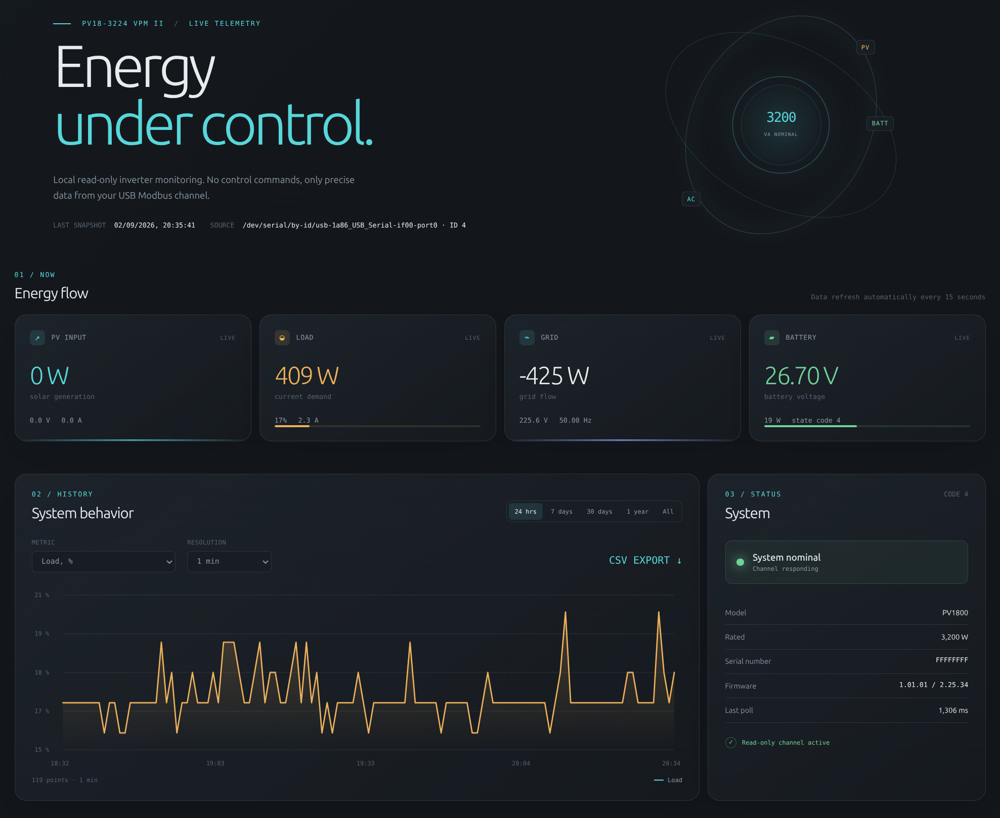
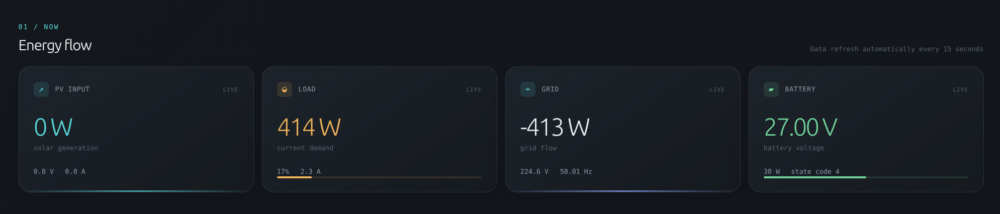
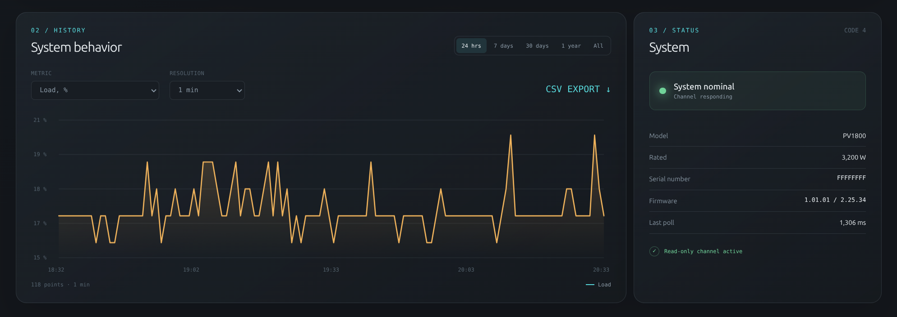
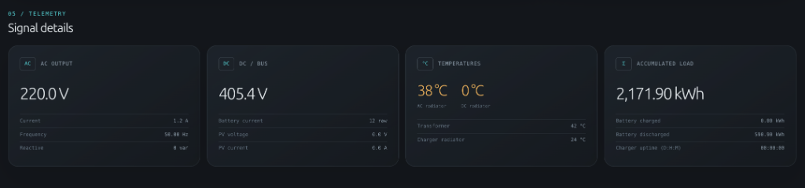
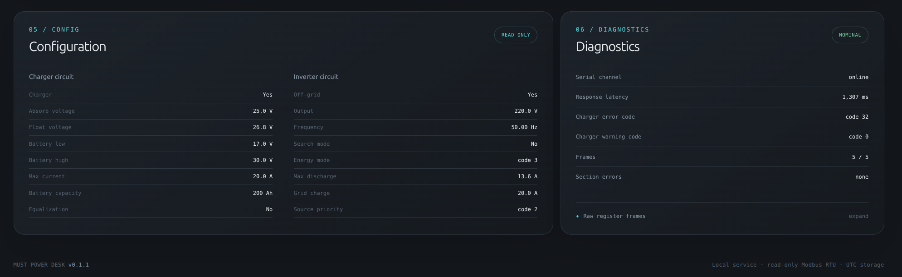
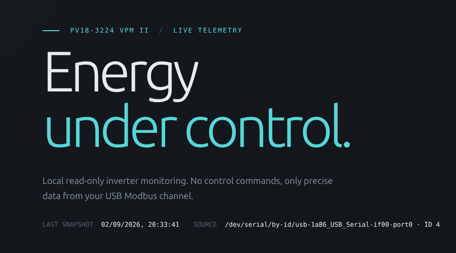
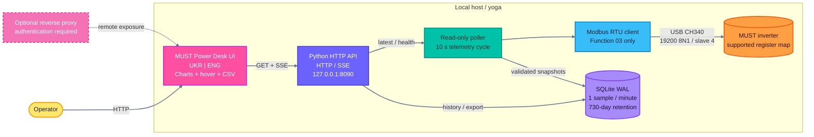

# MUST Power Desk | Solar Inverter Dashboard


MUST Power Desk is a self-hosted, local-first solar inverter monitoring and opt-in safe control dashboard for MUST inverter families that expose the supported Modbus RTU register map. It reads live PV, battery, grid, AC output, load, temperature, and accumulated-energy telemetry through a USB serial adapter, stores time-series history and configuration audit trails in SQLite, streams live updates over Server-Sent Events (SSE), and supports optional Telegram alerts. The responsive UI supports Ukrainian and English (`UKR | ENG`) as well as Dark/Light themes.

It is built for home energy monitoring, solar PV visibility, off-grid and backup-power diagnostics, and safe operation of MUST inverter systems. By default (`MUST_ENABLE_WRITE=false`), the application remains strictly read-only. When write control is explicitly enabled in `.env`, changes are restricted to an allowlisted parameter table with UI unlock timers, Before→After diff previews, Hold-to-Confirm interlocks, EEPROM no-op/cooldown protection, and read-after-write verification.

The live-validated device for this release is a **MUST PV18-3224 VPM II**, identified by the firmware as **PV1800**.

## Dashboard Screenshots

The gallery shows the live-validated MUST PV18-3224 VPM II / PV1800 dashboard. Values shown are example telemetry from a local test system; no control action is available from the UI.

<table>
  <tr>
    <td colspan="2" align="center">
      <a href="screenshots/Screenshot_MUST_Power_Desk-1.png"></a><br>
      <sub><strong>Overview:</strong> live telemetry, energy flow, history, and system status</sub>
    </td>
  </tr>
  <tr>
    <td align="center" width="50%">
      <a href="screenshots/Screenshot_MUST_Power_Desk-2.png"></a><br>
      <sub><strong>Energy flow:</strong> PV input, load, grid, and battery cards</sub>
    </td>
    <td align="center" width="50%">
      <a href="screenshots/Screenshot_MUST_Power_Desk-3.png"></a><br>
      <sub><strong>History and status:</strong> charted behavior with inverter health</sub>
    </td>
  </tr>
  <tr>
    <td align="center" width="50%">
      <a href="screenshots/Screenshot_MUST_Power_Desk-4.png"></a><br>
      <sub><strong>Telemetry:</strong> AC, DC, temperature, and accumulated readings</sub>
    </td>
    <td align="center" width="50%">
      <a href="screenshots/Screenshot_MUST_Power_Desk-5.png"></a><br>
      <sub><strong>Configuration and diagnostics:</strong> read-only parameters and health data</sub>
    </td>
  </tr>
  <tr>
    <td colspan="2" align="center">
      <a href="screenshots/Screenshot_MUST_Power_Desk-6.png"></a><br>
      <sub><strong>Live dashboard header:</strong> local-first MUST inverter monitoring</sub>
    </td>
  </tr>
</table>

## Highlights

- Read-only Modbus RTU polling using function `03` (Read Holding Registers).
- No inverter write commands, remote controls, or configuration mutations.
- Current telemetry for PV, battery, grid, AC output, load, temperatures, and accumulated counters.
- History resolutions: 1 minute, 30 minutes, hour, day, week, month, and raw samples.
- History ranges include 1 hour and 6 hours for short operational checks, plus 24 hours, 7 days, 30 days, 1 year, and all retained data.
- Operational power-flow, battery-voltage, and temperature charts with a six-hour live browser buffer and pointer tooltips.
- Selected-range summary with estimated energy, extrema, grid availability, and data-gap visibility.
- CSV export and a streaming `/api/events` endpoint.
- Bright, responsive dashboard with `UKR | ENG` language switching.
- SQLite WAL persistence with a 730-day default retention policy.
- Localhost binding by default, with documented Tailscale-only deployment, and defensive HTTP/systemd security headers.

## Architecture

The application is deliberately small: a Python standard-library HTTP server, a serial poller, a SQLite store, and a static browser UI.



The optional reverse proxy is not part of the default deployment. If the dashboard is exposed beyond localhost, add authentication, TLS, rate limiting, and an explicit network policy first. A Tailscale-only bind is documented below as the private-network alternative.

## Supported Inverter Models

Compatibility is protocol-scoped, not a claim that every hardware revision of a product family is identical. The decoder recognizes the following MUST machine types from the identity register block:

| Model family | Identity detection | Compatibility status |
| --- | --- | --- |
| `PC1600` | Machine type code `1600` | Register decoder implemented; hardware not validated in this deployment |
| `PH1800` | Machine type code `1800`, legacy software-version branch | Register decoder implemented; hardware not validated in this deployment |
| `PV1800` | Machine type code `1800`, PV software-version branch | **Live validated** with PV18-3224 VPM II |
| `PH3000` | Machine type code `3000` | Register decoder implemented; hardware not validated in this deployment |
| `PV3500` | Machine type code `3500` | Register decoder implemented; hardware not validated in this deployment |

These are the complete model labels currently recognized by the application code. Other MUST models, rebrands, or firmware revisions may work only if they expose the same addresses, lengths, scaling, signed-value conventions, and response framing. Always validate a new device on an isolated serial connection before relying on the readings.

## Requirements

- Linux with access to the USB serial device.
- Python 3.10 or newer.
- `pyserial` 3.5 or newer.
- A MUST inverter with the compatible register map.

## Quick Start

```bash
git clone https://github.com/weby-homelab/Must-Inverter-Dashboard.git
cd Must-Inverter-Dashboard
python3 -m venv .venv
. .venv/bin/activate
python3 -m pip install -r requirements.txt
cp .env.example .env
python3 -m unittest discover -s tests -v
python3 main.py
```

Open `http://127.0.0.1:8090` in a browser. The default `.env` keeps the service on localhost and uses the stable USB by-id path.

### One-command Linux installation

On Debian or Ubuntu, this command installs the OS prerequisites, clones the pinned release, creates the isolated Python environment, installs `pyserial`, creates the non-root service account, enables systemd, runs the tests, and waits for `/healthz`:

```bash
sudo apt-get update && sudo apt-get install -y ca-certificates curl && curl -fsSL https://raw.githubusercontent.com/weby-homelab/Must-Inverter-Dashboard/v0.2.1/install.sh | sudo bash
```

The installer places the application in `/opt/must-inverter-dashboard`, creates the `mustdash` account with serial access through `dialout`, and starts `must-inverter-dashboard.service`. If a `/dev/serial/by-id/` adapter is present, its first device is selected automatically; otherwise edit `/opt/must-inverter-dashboard/.env` before starting the service. The installer is intended for a clean or previously installer-managed directory and refuses to overwrite a checkout with local changes.

## Configuration

All runtime settings are optional and are documented in `.env.example`:

| Variable | Default | Purpose |
| --- | --- | --- |
| `MUST_DASH_HOST` | `127.0.0.1` | HTTP bind address; use this node's Tailscale IPv4 for tailnet-only access |
| `MUST_DASH_PORT` | `8090` | HTTP port |
| `MUST_SERIAL_PORT` | `/dev/serial/by-id/usb-1a86_USB_Serial-if00-port0` | Stable serial device path |
| `MUST_SLAVE_ID` | `4` | Modbus unit ID |
| `MUST_BAUDRATE` | `19200` | Serial baud rate; framing is 8N1 |
| `MUST_POLL_INTERVAL` | `10` | Telemetry poll interval in seconds |
| `MUST_SAMPLE_INTERVAL` | `60` | Minimum persistence interval in seconds |
| `MUST_CONFIG_INTERVAL` | `300` | Read-only configuration refresh interval |
| `MUST_SERIAL_TIMEOUT` | `2.5` | Serial response timeout in seconds |
| `MUST_INTER_REQUEST_DELAY` | `0.5` | Delay between Modbus requests |
| `MUST_RETENTION_DAYS` | `730` | SQLite retention window |
| `MUST_DB_PATH` | `data/inverter.sqlite3` | SQLite database path |
| `MUST_ENABLE_WRITE` | `false` | Opt-in allowlisted Modbus Function `06` parameter writes |
| `MUST_WRITE_UNLOCK_TTL` | `300` | UI control unlock timeout in seconds |
| `MUST_WRITE_COOLDOWN` | `3.0` | Minimum delay between EEPROM register writes |
| `MUST_MAX_WRITES_PER_HOUR` | `30` | Hourly write budget ceiling |
| `MUST_TELEGRAM_ENABLED` | `false` | Opt-in Telegram alerts for outages, low battery, faults |
| `MUST_TELEGRAM_BOT_TOKEN` | - | Telegram bot token (keep only in server `.env`) |
| `MUST_TELEGRAM_CHAT_ID` | - | Target Telegram chat ID |
| `MUST_ALERT_LOW_BATTERY_V` | `24.6` | Low battery alert threshold (V) |
| `MUST_ALERT_COOLDOWN_SECONDS` | `900` | Minimum interval between repeat alerts |

The poller reads the inverter every 10 seconds, while persistence remains rate-limited to one sample per minute. The dashboard receives every successful snapshot over SSE and keeps a six-hour in-browser live buffer for operational charts; the SQLite history remains compact and durable.

## Modbus Register Map

The application reads only the following verified holding-register blocks. Addresses are shown using the device documentation's one-based notation.

| Section | Start | Count | Data |
| --- | ---: | ---: | --- |
| `identity` | `20001` | `16` | Model, serial, hardware/software versions |
| `charger_status` | `15201` | `21` | PV voltage/current/power, charger state, temperatures, accumulated PV energy/time |
| `inverter_status` | `25201` | `79` | AC, grid, load, battery, power, temperatures, accumulated energy counters |
| `charger_config` | `10101` | `24` | Read-only charging parameters |
| `inverter_config` | `20101` | `44` | Read-only inverter parameters |

Every response is framed and CRC-validated before decoding. A failed section is reported as degraded data instead of being silently treated as valid.

PV1800 accumulated counters use decimal high/low words, not a binary 32-bit value: `high * 1000 kWh + low * 0.1 kWh`. The API keeps the existing `*_power_wh` field names and exposes the normalized result in Wh, which the dashboard renders in kWh. Charger registers `15219-15221` are accumulated `day:hour:minute` and are displayed as `D:H:M`.

## History Resolutions

`/api/history` and `/api/export.csv` support these period values:

| Period | Aliases | Behavior |
| --- | --- | --- |
| `raw` | - | Raw samples, limited to the newest 20,000 points |
| `minute` | `1m` | One UTC bucket per minute |
| `30m` | `30min` | UTC buckets starting at minute `00` or `30` |
| `hour` | - | One UTC bucket per hour |
| `day` | - | One UTC bucket per UTC day |
| `week` | - | Monday-based UTC week bucket |
| `month` | - | One UTC bucket per month |

When `period=auto` or no period is supplied, the server selects `minute` for ranges up to 6 hours, `30m` up to 3 days, `day` up to 45 days, `week` up to 180 days, and `month` for longer ranges.

`/api/summary?range=24h` analyzes the raw samples in the selected range. It returns per-metric min/average/max values, sample coverage, gaps, unavailable-grid intervals, and estimated energy. Energy is trapezoid-integrated from persisted power samples; intervals longer than 15 minutes are excluded. The decoded MUST sign convention is used for estimates: negative grid power is import, positive battery power is discharge, and negative battery power is charge. These are estimates and should not replace the inverter's accumulated counters.

The dashboard exposes one-hour and six-hour history ranges in addition to the longer views. Operational charts combine the selected persisted range with the latest six hours of live snapshots and are refreshed every 10 seconds.

## API

| Endpoint | Description |
| --- | --- |
| `GET /api/current` | Latest decoded snapshot and health object |
| `GET /api/health` | Poller status, errors, latency, and SQLite statistics |
| `GET /healthz` | Readiness endpoint; returns `503` when offline or stale |
| `GET /api/history?range=24h&period=minute` | One-minute history |
| `GET /api/history?range=24h&period=30m` | Thirty-minute history |
| `GET /api/history?range=30d&period=day` | Daily aggregation |
| `GET /api/history?range=1y&period=month` | Monthly aggregation |
| `GET /api/history?range=24h&period=raw` | Newest raw samples |
| `GET /api/summary?range=24h` | Quality, extrema, and estimated energy for raw samples |
| `GET /api/outages?range=7d` | Grid outage timeline and total outage duration |
| `GET /api/export.csv?range=30d&period=day` | CSV export for the same history query |
| `GET /api/control/status` | Safe write enablement, unlock state, interlocks, allowlist |
| `GET /api/control/audit?limit=50` | Configuration write audit trail |
| `POST /api/control/unlock` | Unlock write session for `MUST_WRITE_UNLOCK_TTL` seconds |
| `POST /api/control/lock` | Immediately re-lock write session |
| `POST /api/control/preview` | Validate and compute Before→After diff without writing |
| `POST /api/control/write` | Apply allowlisted changes with Function `06` + verification |
| `POST /api/control/preset` | Apply a named safe preset (`fast_charge`, `gentle_charge`, `ups_utility`, `solar_first`) |
| `POST /api/control/rollback` | Restore a previous configuration value from audit history |
| `GET /api/events` | Server-Sent Events for snapshots and health changes |

Example requests:

```bash
curl -fsS http://127.0.0.1:8090/api/health
curl -fsS 'http://127.0.0.1:8090/api/history?range=24h&period=1m'
curl -fsS -OJ 'http://127.0.0.1:8090/api/export.csv?range=30d&period=day'
```

## systemd Deployment

The repository includes `deploy/must-inverter-dashboard.service`. The unit runs as non-root user `mustdash`, adds only the `dialout` group for serial access, and applies systemd filesystem/device hardening. The one-command installer above is the recommended path.

```bash
sudo useradd --system --user-group --home-dir /opt/must-inverter-dashboard --shell /usr/sbin/nologin mustdash
sudo usermod --append --groups dialout mustdash
sudo install -d -o mustdash -g mustdash -m 0750 /opt/must-inverter-dashboard/data
sudo install -o root -g mustdash -m 0640 .env.example /opt/must-inverter-dashboard/.env
sudo install -m 0644 deploy/must-inverter-dashboard.service /etc/systemd/system/must-inverter-dashboard.service
sudo systemctl daemon-reload
sudo systemctl enable --now must-inverter-dashboard.service
systemctl status must-inverter-dashboard.service
journalctl -u must-inverter-dashboard.service -f
```

The default deployment binds only to `127.0.0.1:8090` and grants write access only to `data`. Do not expose the service directly to the Internet.

### Tailscale-only access

Keep the default loopback bind for a local-only deployment. To make the dashboard reachable from the Tailscale network without opening it on public or LAN interfaces, set `MUST_DASH_HOST` in the service environment file to this node's Tailscale IPv4 address (the `100.x.y.z` value from `tailscale ip -4`):

```bash
sudoedit /etc/must-inverter-dashboard.env
# MUST_DASH_HOST=100.x.y.z
sudo chmod 0640 /etc/must-inverter-dashboard.env
sudo systemctl restart must-inverter-dashboard.service
curl -fsS "http://$(tailscale ip -4):8090/healthz"
```

The environment file must be readable by the service account. Do not replace the address with `0.0.0.0`. Verify the listener with `ss -ltnp` and test the health endpoint from another authorized Tailscale peer.

## Security Model

- Write control is opt-in and disabled by default (`MUST_ENABLE_WRITE=false`).
- Only allowlisted `101xx`/`201xx` configuration registers can be written via Function `06`, with range bounds, 24V threshold ordering invariants, no-op skipping, cooldown throttling, and read-after-write verification.
- Control endpoints require same-origin / `X-Requested-With` CSRF protection, an active unlock session, and live telemetry interlocks (`offline`/`stale` blocks writes).
- The HTTP server defaults to loopback binding; Tailscale exposure binds to the node's Tailscale address, never `0.0.0.0`.
- Responses include CSP, frame, MIME-sniffing, referrer, permissions, and cross-origin policy headers.
- `.env`, SQLite databases, logs, and Python caches are excluded by `.gitignore`.
- Keep credentials outside the repository and never place tokens in README, source, issues, or release notes.

## Development and Verification

```bash
python3 -m unittest discover -s tests -v
python3 -m compileall -q .
node --check public/app.js
curl -fsS http://127.0.0.1:8090/healthz
```

The test suite covers signed register decoding, CRC and Modbus exception handling, HTTP readiness/security headers, SQLite migration, raw history limits, automatic period selection, and minute/30-minute bucket aggregation. Browser verification should also move the pointer over each chart and confirm the timestamp and series values in the tooltip.

## v0.3.0 Release Notes

- Added opt-in safe inverter control (`MUST_ENABLE_WRITE=false` by default) using Modbus Function `06` with allowlisted Tier 1/Tier 2 parameters, 24V threshold cross-validation, EEPROM no-op skipping, cooldown/hourly limits, and read-after-write verification.
- Added control safety UX: session unlock timer, Before→After diff preview, Hold-to-Confirm interlock, quick presets, and SQLite configuration audit trail with one-click rollback.
- Added animated SVG power flow schematic, human-readable `UKR | ENG` decoding of modes and error/warning bitmasks, battery autonomy estimate, and grid outage timeline (`/api/outages`).
- Added pointer/touch chart tooltips for mobile devices and Dark/Light theme toggle.
- Added opt-in Telegram alerts (`MUST_TELEGRAM_ENABLED`) for grid outages/restoration, low battery voltage, critical faults, and telemetry loss.

## v0.2.1 Release Notes

- Added pointer tooltips to the history, power-flow, battery-voltage, and temperature charts.
- Added nearest-sample timestamps, localized series labels, units, and unavailable-value handling to chart tooltips.
- Documented and deployed an opt-in Tailscale-only bind without exposing the dashboard on `0.0.0.0`.
- Updated the installer and health/server version metadata for the release.

## v0.2.0 Release Notes

- Added one-hour and six-hour dashboard history ranges with minute defaults.
- Added live operational charts for power flow, battery voltage thresholds, and temperatures.
- Reduced the default telemetry cycle and dashboard refresh cadence from 15 seconds to 10 seconds.
- Kept SQLite persistence at one sample per minute to avoid unnecessary database growth.

## v0.1.1 Release Notes

- Added one-minute and 30-minute history aggregation.
- Added automatic fine-resolution selection for short ranges.
- Added `UKR | ENG` language switching with browser persistence.
- Extended localization across current, history, diagnostics, and configuration views.
- Added version reporting to health responses.
- Documented the supported decoder model families and the read-only security boundary.

## Contributing

Contributions are welcome through issues and pull requests. Hardware compatibility changes should include the inverter model, firmware version, register evidence, and tests that do not send write commands.
